# 视频工坊 · narrated-video-studio

**三条线，一套引擎。讲解线讲清楚一件事；宣传线让人记住一样东西；口播线把你录好的一段口播配上画面。**

一个 Agent Skill（主要在 Claude 上用），加上它配套的工具箱：**你说要讲什么，Claude 拆你的提示词、比较几个讲法、查资料、写稿、配音、用代码画画面、检查、出片。** 横版长片和抖音、小红书、视频号的竖版都能直接做。 适合讲解类和叙事类视频——科普、历史、人物、AI 与科技、小说、工业零部件、制造业隐形冠军、企业介绍、生产流程、数据、新闻、谣言核查。 不只是讲解：无旁白的诗意短片、按音乐节拍卡点的片子也能做。**给一个公众号文章的链接，也能直接讲成视频。**

2026-10-11 起多了一条**宣传线**：产品宣传与发布、发布会用片、城市形象、场景与空间介绍、项目推介、生产宣传片。它和讲解线反着来——先定音乐和拍点，再排镜头，镜头短、字少，检查多一项“镜头节奏”。这条线刚搭起来，只有一条虚构产品的样片，见下面“宣传线”一节。

画面全部由代码逐帧画出来（HTML canvas → 截帧 → ffmpeg），所以每一帧都可以复现、可以检查、可以改一个字再渲一遍。照片和视频片段只在“必须看到真东西”的那几拍剪进来，并且要过授权台账。

## 做出来是什么样

### 先看会动的

下面七段都是从成片和样片里直接截的，每段五到八秒。

| | | |
|---|---|---|
| 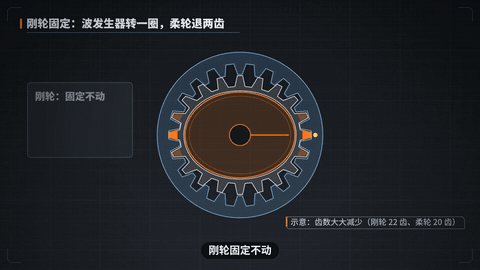 | 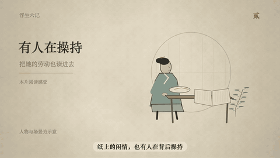 |  |
| **讲机构**：谐波减速器怎么咬合，数字跟着旁白走（成片《一圈会弯的齿》） | **讲文学**：七夕刻的两方印盖在工笔画上，原话标出是谁说的、出自哪一卷（成片《浮生六记｜烟火神仙》，AI 生成的想象画像） | **无旁白、卡点**：换季卡在小节线上，落下来的东西跟着拍子（样片《四时》） |
|  | 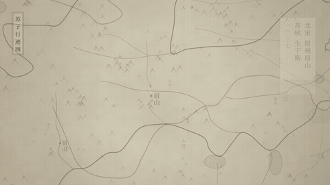 | 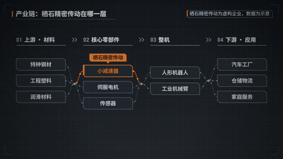 |
| **换一种画法**：同一幅画变成旋动的笔触，再用墨晕转进点彩（艺术引擎样片） | **一张地图讲一个人**：朱线从出生地走出去，竖排的字跟上（水墨行迹地图样片） | **拆开看**：产业链在哪一层、一台减速器里有什么（产业图谱样片，虚构企业） |


**宣传线、卡点快切**：一拍一屏连切六次，停在一个问题上，空一小节，小节线上砸出名字（样片《青梧》，虚构产品，120 拍）

### 做过的成片

前五条都走完了查证、写稿、配音、回听、检查、出片的整条流程：前四条从一句话开始，第五条从一篇公众号文章开始。第六条没有旁白，是用数学规则画出来的短片。

**科普原理 · 《天为什么是蓝的》**（3 分 17 秒，有旁白，给孩子看）

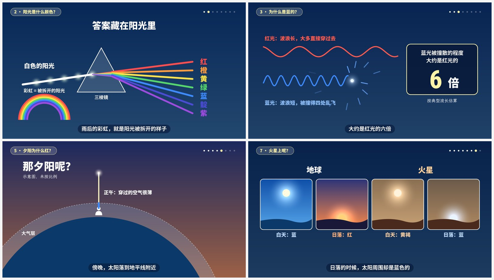

**工业零部件 · 《轴承为什么能让轮子转得这么轻》**（1 分 37 秒，蓝图风格）

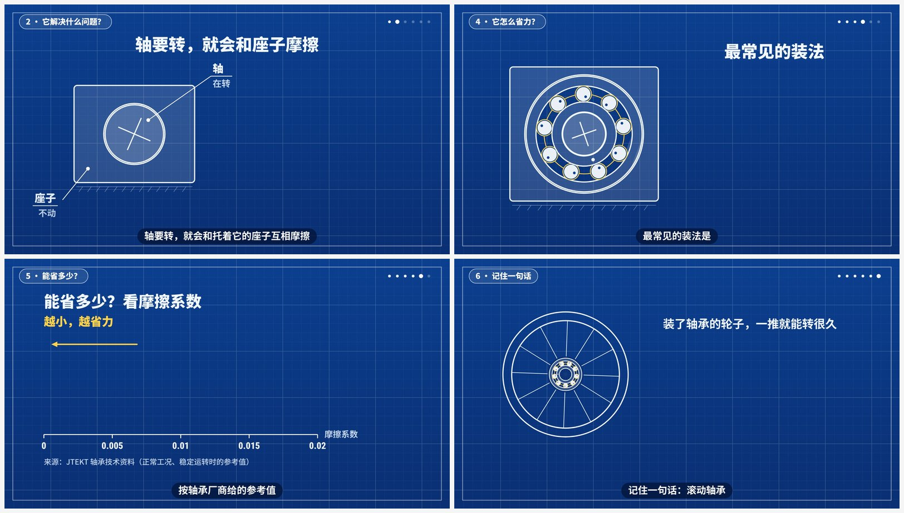

**制造业隐形冠军 · 《一圈会弯的齿：绿的谐波和谐波减速器》**（4 分 46 秒）。从人形机器人的关节切进去，讲清谐波减速器怎么靠“少两个齿”减速，再讲这家公司。每个数字旁边都带来源；公司自己说的写成“公司称”；两份报告的份额口径对不上，就直说对不上；全片挂着“不构成投资建议”

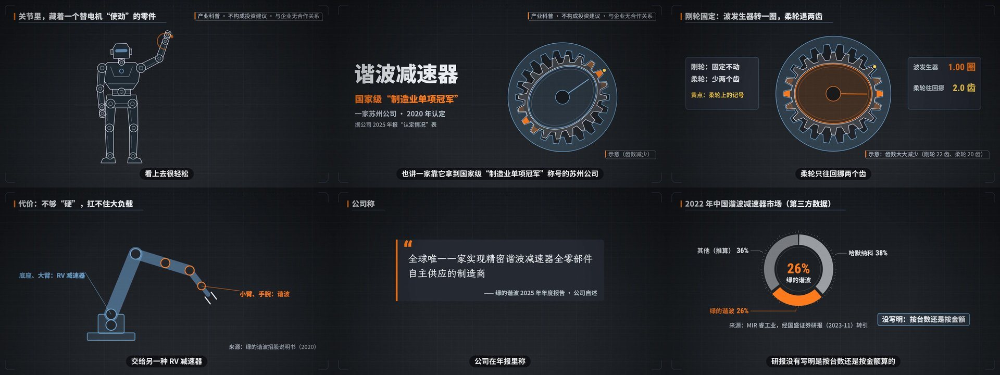

**小说与文学 · 《浮生六记｜烟火神仙》**（9 分 55 秒）。六记都讲到：前四记讲沈复和陈芸平常又超脱的日子，从藏起来的一碗热粥、七夕刻的两方“愿生生世世为夫妇”，到太湖边那句“天地之宽”和临终的“来世”；卷五、卷六原稿已经失传，只讲确实知道的，并点明 1935 年“足本”里的两卷是伪作。人物和场景是 AI 生成的工笔想象画像（先出两人的定妆像，每场以它为参照），画面标“AI 生成想象画像，非本人像”；旁白之外，芸和沈复的原话各用一个声音，引文标卷次

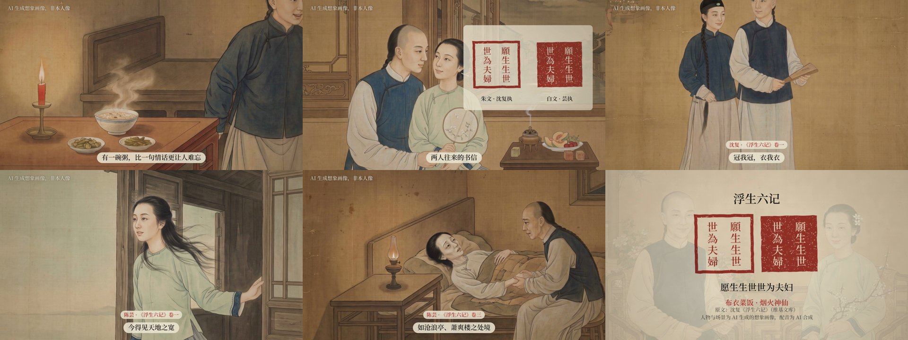

**文章转视频 · 《先拆岗位，再拆流程》**（2 分 49 秒）。来源是一篇约 2400 字的公众号文章（作者本人的）。视频稿 763 字，没有照原文的七节顺序念：开头换成钩子，十七个 Skill 只留数目和四个阶段；强调色用的是文章自己的深绿

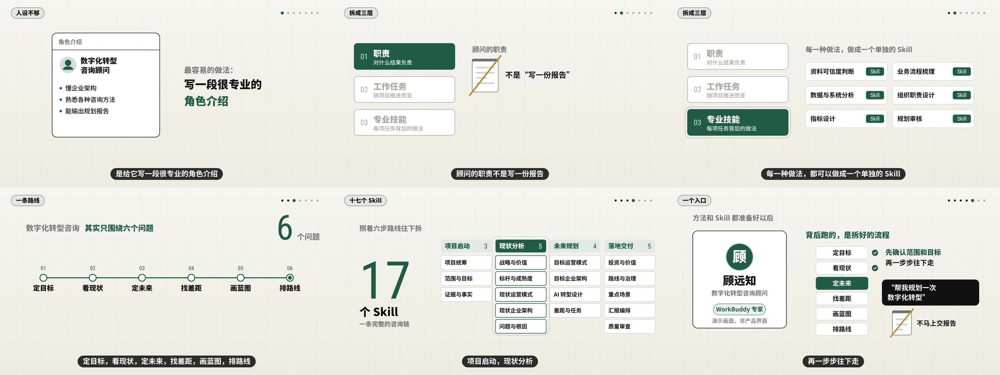

**数学影像 · 《一个点 A POINT》**（1 分 56 秒，没有旁白）。七万个点从头用到尾：一个点炸开，长成星系、向日葵、双螺旋、神经网络、晶格，排成一个问号，散成噪声，再收回一个点。每一场是一条数学规则，换场时点不换、只换规则；角上那一行代码或公式就是画这一场的规则。同一份场景出了中文、英文、中英双语三版，横版竖版各一套。画面是规则的示意，不是物理模拟。做法见 [`templates/生成艺术短片.md`](templates/生成艺术短片.md)。

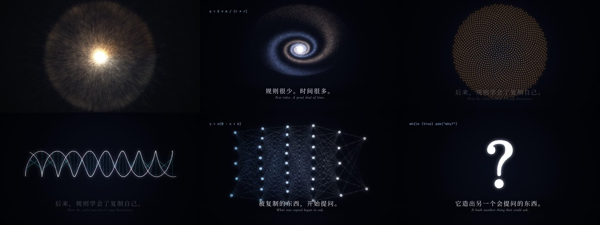

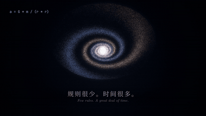

**这两条的竖版**（指上面《浮生六记》和《一圈会弯的齿》）：不是把横版裁窄，是另写一份更短的旁白、按竖屏重新排（上排是上一版《浮生六记：一碗粥里的余生》的竖版，55 秒；下排《一圈会弯的齿》，42 秒）

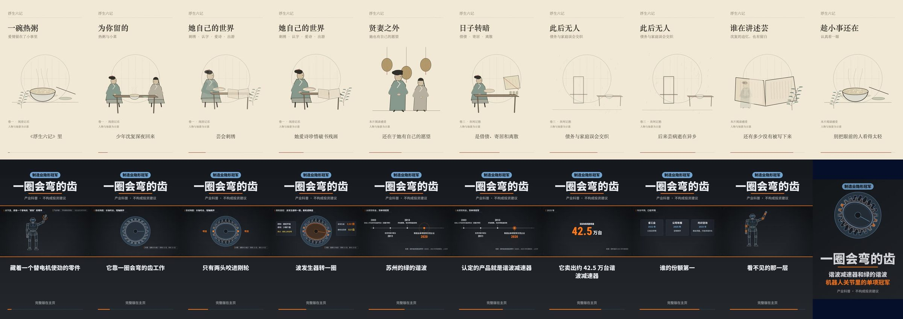

### 宣传线：音乐定节奏的那一类

讲解线是“稿子 → 配音 → 画面”，画面挂在旁白念到哪个词上。宣传片这样做会拖：镜头长、剪辑点不踩拍。宣传线把顺序反过来：

| | 讲解线（缺省） | 宣传线（`brief.json` 写 `"mode":"promo"`） |
|---|---|---|
| 用在 | 讲清楚一件事 | 让人记住一样东西 |
| 谁定节奏 | 旁白 | 音乐拍点（`bpm`），时刻用 `beatT` / `barT` 取 |
| 镜头 | 一句一场，3–6 秒 | 平均 2.5 秒以内，有快有慢 |
| 屏幕上的字 | 要读得完 | 扫一眼的大字，一拍一屏最多三个字 |
| 旁白 | 主角 | 可以没有 |
| 多查的 | — | 镜头节奏、口号有没有在片尾留住 |
| 不变的 | 断言台账、素材授权、极限词、复盘 | 同左 |

做法是五步：先写口号和行动号召 → 定音乐（自己的音乐用 `build.py beats` 量拍速）→ 排小节表（每段几小节、每个镜头几拍）→ 写场景 → 检查。完整的写在 [`templates/宣传片.md`](templates/宣传片.md)。

样片《青梧》（虚构产品，34 秒，120 拍，21 个镜头，无旁白）：痛点连切、亮相、三个卖点、三个数、口号。界面是重画的，角上一直标“演示画面”；数字标“示意数据”。

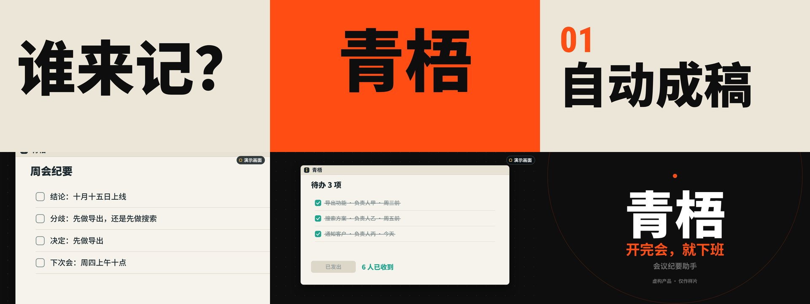

`check` 对这条样片量出来的是：`镜头 21 个，平均 1.6 秒，最长 4.0 秒，短的约 0.5 秒、长的约 2.0 秒；换镜头 20 次，20 次在拍点上`。镜头太长、长短都一样、不在拍点上、口号一闪而过，都会报出来。

**宣传片不都长一个样。**先在 `brief.json` 写产品是哪一类（虚拟产品、实体产品、工具类、智能化产品）和几个特性词，`build.py look` 会从五种样子里给出建议；样子定了，字怎么进场、镜头怎么换、配什么音乐、多快的拍子、镜头多长，一起跟着定。

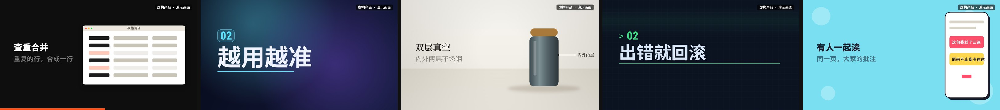

| 样子 | 适合 | 动效 | 配乐 |
|---|---|---|---|
| 大字撞色 `bold` | 效率工具、直接的东西 | 大词砸下来，硬切 | 利落的电子 |
| 暗场光感 `glass` | AI、智能化产品 | 字浮上来带光晕，换镜头扫过一道光 | 冷静的琶音 |
| 影棚留白 `studio` | 看得见摸得着的实物 | 镜头慢推，叠化 | 温和的电钢琴 |
| 工程网格 `grid` | 开发者工具、流程 | 字是打出来的，按栏擦切 | 冷静的琶音，快一点 |
| 彩块弹跳 `pop` | 课程、会员、内容、生活类 | 字一个个弹出来，圆涨开换屏 | 轻快的木琴和拍手 |

上面五格是同一副骨架、五个虚构产品的样片。

现在做到哪：做过一条成片（给这个 skill 自己做的发布短片），其余是虚构产品的样片。五种样子和四种配乐是 2026-10-12 新做的，配乐是程序合成的，没有人听过；实体产品只用简笔示意图试过。城市形象、场景介绍、生产宣传这三类靠实拍；要质感，得你提供真实录屏、实拍素材和有授权的音乐。

### 口播线：你录一段口播，它配上画面

你对着镜头讲完一段（分析一个问题、讲一个观点），把视频给它。它先转写、读懂你讲了什么，把你的人像固定在一个角上，其余画面按你讲的内容生成：讲到哪一点，卡片就换到哪一点，要点一条条累加，字幕里的关键词变色。横版竖版共用一份场景。

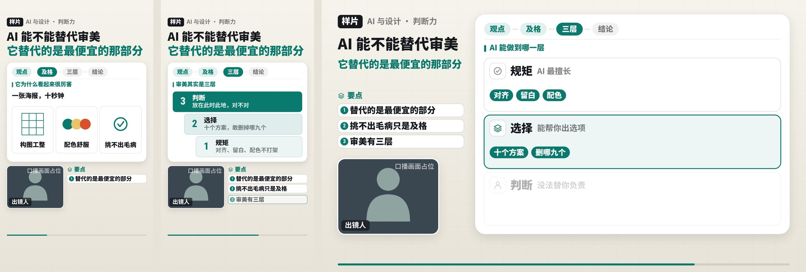

怎么做的：`brief.json` 写 `"mode":"talk"`，`build.py talk` 转写出一句一行的稿子；校对错字、删掉口误的句子后再跑一遍，它按留下的句子把口播剪好，长停顿收紧；画面上每样东西挂在你说到的那个词上。声音就是你的原声，不重新配音。完整做法在 [`templates/口播片.md`](templates/口播片.md)。

现在做到哪：只用一段合成的口播（合成声音、占位画面）跑通过，60 秒的素材剪成 53 秒。**还没有用真人录的口播试过。**版面只有“人在角上”这一套。上面的图是样片，角上是占位的人像框。

### 从一篇公众号文章到视频

给一个 `mp.weixin.qq.com` 的链接（或另存的网页、贴了正文的文本），说“把这篇讲成视频”：

| 步骤 | 做什么 |
|---|---|
| 先问一句 | 这篇文章是你自己的、已获授权的，还是要介绍和评论别人的文章。三种情况能用的程度不一样，检查不会替你猜 |
| 取文 | `python3 kit/article.py fetch 链接`：拆出标题、公众号、发布时间、小标题、引文、列表、配图，去掉文末的“往期推荐、关注我们” |
| 内容分析 | 篇幅（照着念要几分钟、建议做多长）、结构、题材建议、文章自己的主色、哪些句子适合做大数字、图表、时间轴、对比、流程，以及一份“要核实的说法”清单 |
| 配风格 | 从题材卡推荐的风格里选，强调色用文章自己的颜色，语气跟文章的口吻走 |
| 重讲 | 视频稿通常是原文的两到三成：开头换成钩子，顺序按观众理解的顺序排。不是把文章念一遍 |
| 查证 | 文章里的数字、年份、引语逐条核对；只有文章自己这么说的，稿子里写“文章认为” |
| 检查多一项 | “原文依据”：把旁白和原文逐字比。介绍别人的文章有四分之一以上照搬，不让出片；别人的文章要在画面上注明出处 |

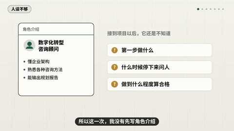

做法和规矩在 [`templates/文章转视频.md`](templates/文章转视频.md)。全是图片的文章读不出字；微信要求验证时，需要自己另存网页或贴正文。

### 能做哪些片子

二十二张题材卡，分两条线。先是讲解线的十六张，每张给出这类内容怎么讲（节拍、占比、常见错）。说一句话就能开工：

| 题材 | 可以这样说 | 画面 | 成片或风格样片 |
|---|---|---|---|
| 科普原理 | “给小学生讲清楚月亮为什么会变形状” | 夜空、实验室、扁平发光、白板 | 成片《天为什么是蓝的》 |
| 历史事件 | “讲讲 1969 年登月那八天” | 档案风、年代戳、时间轴、桌面拼贴 | 样片 `collage` |
| 人物传记 | “三分钟讲完居里夫人” | 档案风或水墨，时间轴、引文卡 | 样片 `components` |
| AI 与科技产品 | “介绍一下我们这个 App 的新功能” | 发布会风、活体录屏、全息界面 | 样片 `ui`、`holo`、`kinetic` |
| 小说与文学 | “讲讲《浮生六记》里的陈芸” | 工笔想象画像，引文标出处 | 成片《浮生六记｜烟火神仙》 |
| 工业零部件 | “轴承为什么能让轮子转得这么轻” | 蓝图、等距沙盘、标注和参数表 | 成片《轴承为什么省力》 |
| 企业介绍 | “给我们公司做一条两分钟的介绍” | 瑞士网格、大数字、时间轴，可剪进实拍 | 样片 `recut` |
| 生产流程 | “一颗螺丝是怎么做出来的” | 蓝图或等距沙盘，工序条 | 样片 `iso` |
| 数据解读 | “把这张表讲成一条一分钟的片子” | 柱图、折线，一根主角其余退灰 | 样片 `morph` |
| 新闻与谣言核查 | “这三条说法哪条是真的” | 案卷：证物卡、存疑章、结论计数 | 样片 `dossier` |
| 人物行迹 | “像《东坡》那样，做一条李清照的” | 水墨 + 行迹地图，可以不要旁白 | 样片 `map`、`ink` |
| 行旅日记 | “跟着这本日记走一遍这条路” | 石印画报：版框、题签、日数里数 | 样片 `litho` |
| 双线叙事 | “一个小人物和她身后的大时代” | 漆屏风：上下两栏并行 | 样片 `lacquer` |
| 制造业隐形冠军 | “讲一家做谐波减速器的隐形冠军” | 产业图谱：产业链、爆炸图、份额环 | 成片《一圈会弯的齿》 |
| 诗意影像 | “做一条一分钟的无旁白短片，四季，卡着音乐走” | 一个母题贯穿，按节拍换场，可叠笔触和胶片 | 样片 `beat`《四时》 |
| 数学影像 | “做一条两分钟的无旁白短片：宇宙、智能、起源与终结，中英双语” | 几万个点从头用到尾，一场一条数学规则，同一批点换规则 | 成片《一个点》，样片 `gen` |

**宣传线**（2026-10-11 新增，`brief.json` 写 `"mode":"promo"`）：上面这些卡是“讲清楚一件事”，旁白定节奏；下面六张是“让人记住一样东西”，音乐拍点定节奏，镜头短、字少，检查多一项“镜头节奏”。做法在 `templates/宣传片.md`。目前只有一条虚构产品的样片，还没有成片。

| 题材 | 可以这样说 | 画面 | 样片 |
|---|---|---|---|
| 产品宣传与发布 | “给新版本做一条 30 秒的发布短片，发朋友圈” | 大字快切、真实界面或重画的演示画面、三个数、口号 | 样片 `promo`《青梧》 |
| 发布会用片 | “发布会开场片，一分钟，把场子带起来” | 主题词、快切、转场；另有演示段和大屏循环片 | 还没有 |
| 城市形象 | “给我们区做一条两分钟的形象片” | 实拍为主，地图、数据、地名条 | 还没有 |
| 场景与空间介绍 | “介绍一下我们的园区／展厅／工厂” | 实拍按动线走，或等距沙盘讲布局 | 还没有 |
| 项目推介 | “路演用的一条两分钟的项目介绍” | 方案步骤、进度、数据带出处，可以有旁白 | 还没有 |
| 生产宣传片 | “让客户看到我们的产线靠得住” | 实拍工序卡拍子，质检读数，规模数字 | 还没有 |

还有几种不算题材、但常用的做法：从一篇公众号文章改编（见上一节，题材由文章内容定）、带笑点的第一人称讲述（简笔角色 `stick`）、讲解员串场（`host`）、器物图版（铜版画 `engrave`）、厚重的历史与文学（木刻 `woodcut`）、把自己拍的或已授权的视频重新剪一条（`recut`）。上表里的“样片”都在 `kit/gallery/` 下，是能直接跑的小项目，照着改最快。

### 画面风格

**宋式水墨 + 行迹地图**：一张地图讲一个古人的一生（可以无旁白，只有画面和配乐）

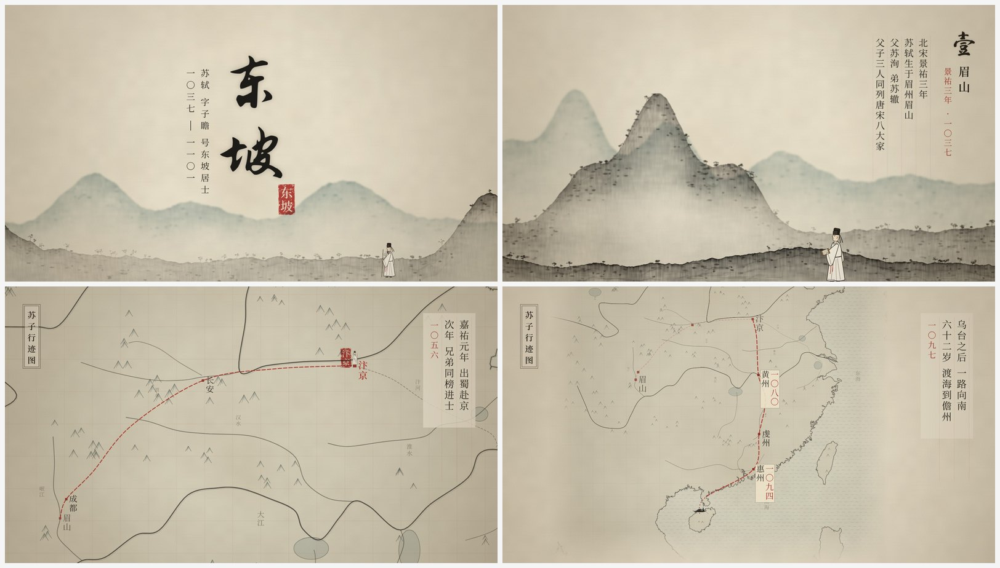

**石印画报、漆屏风**：跟着一本日记走一条路；小人物与大时代上下两栏并行

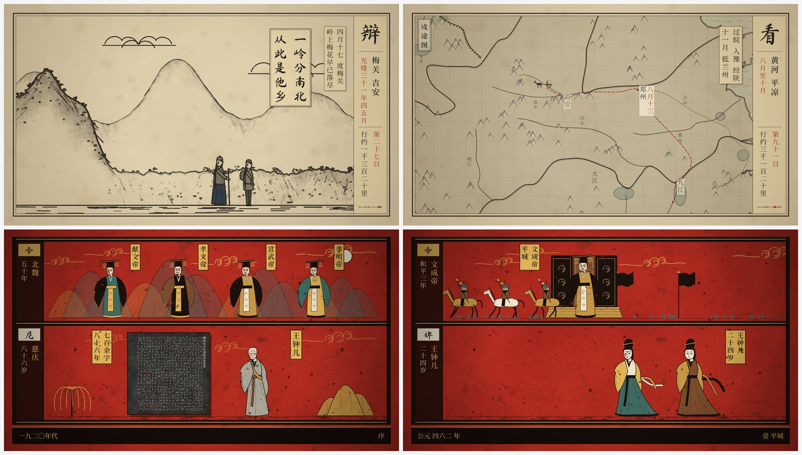

**八套自己实现的风格包**：扁平发光世界、概念形变、白板手写、桌面拼贴（上排）；动态文字、等距沙盘、全息界面、活体录屏（下排）。每套都有招牌组件和一条能跑的样片

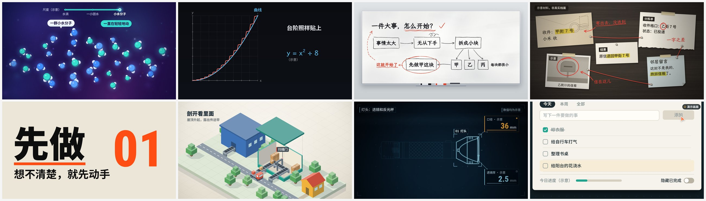

**又六套**：简笔角色故事、讲解员串场、铜版画（上排）；木刻版画、案卷、产业图谱（下排）。讲解员和简笔人都是本项目自己设计的形象

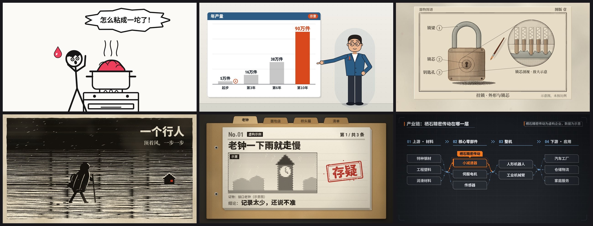

**艺术引擎**：同一幅画换几种画法——旋动的短笔触、点彩、马赛克转场、马赛克、老胶片、明暗法。它是叠在任何风格包上面的一层，绘画库、动效库和转场库改自 [alchaincyf/huashu-art-motion](https://github.com/alchaincyf/huashu-art-motion)（MIT）

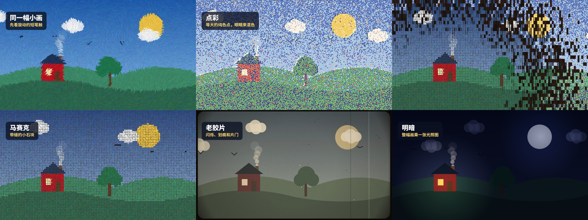

**器物解剖**：把一个原理讲成一台看得见的小器械——许多小而准的实体零件、四档明暗、只有此刻要看的那一件高亮，读数、指针和零件都由同一个模型驱动，推近看每处都有真零件。上排纸白、下排深灰；样片是一台虚构的弹簧测力台（数据示意）。几何库改自 [wheresryan22/anatomy](https://github.com/wheresryan22/anatomy)（MIT）

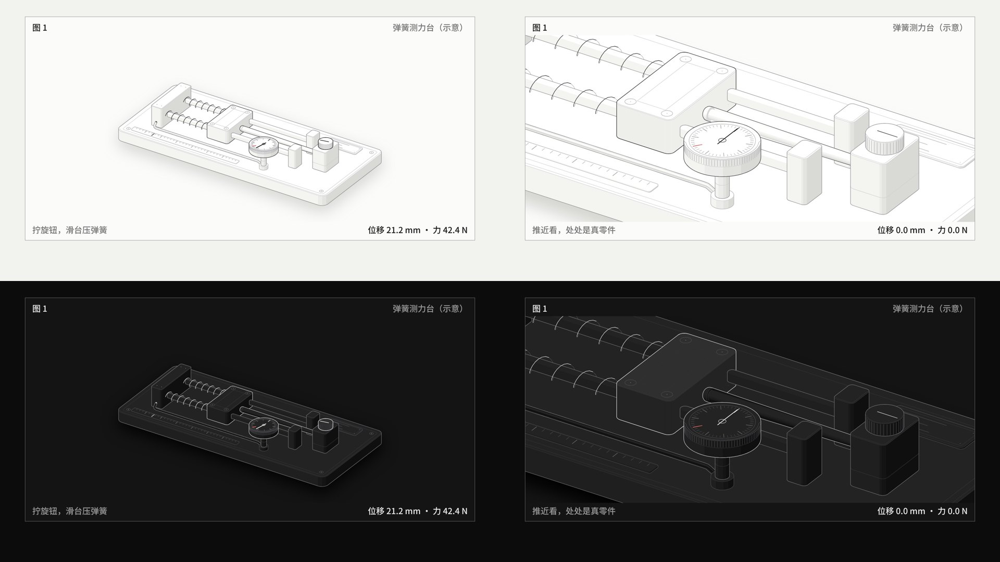

**制造业隐形冠军 + 重新剪辑素材**：上排是产业图谱包——人形机器人的关节里藏着哪些零件、零件爆炸图、份额和“进口 / 国产”对比（样片用的是虚构企业，数据为示意）；下排是剪辑能力——竖拍素材放进横框的三种铺法、片段之间的擦切、原声先进的 J-cut

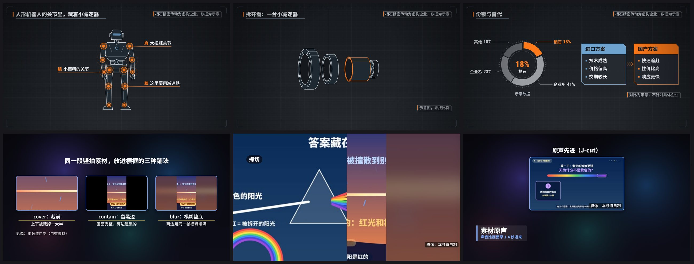

**原生竖版**：抖音、视频号 9:16，小红书 3:4。画面按竖屏重新排，重要的东西都在平台按钮和文案盖不到的安全区里；字幕放大、放在安全区底边。下面是竖版样片《一封没寄出的信》（虚构，悬念倒叙，配音按句子换语气）

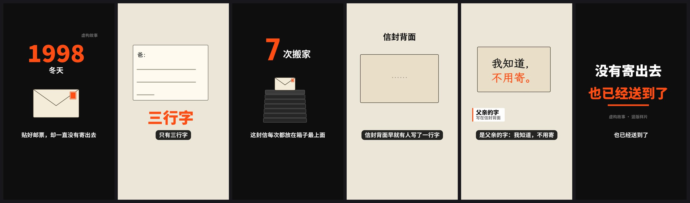

**通用组件换一套风格就是另一种片子**：年代戳、时间轴、引文、大数字、柱图、参数表、标注……

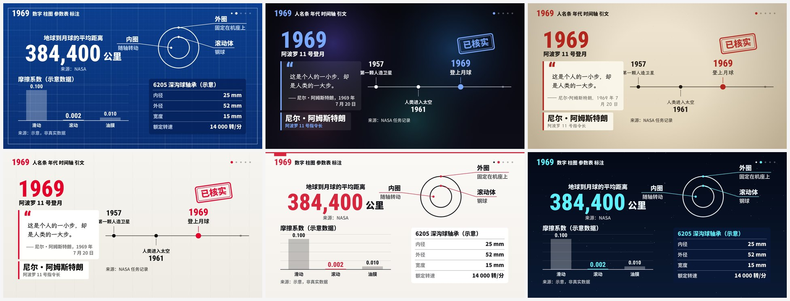

每条片子交付：横版成片（1920×1080，带 2 秒封面）、竖版短片（重写旁白，不是硬裁）、横竖封面、`.srt` 字幕、断言台账、素材来源与授权清单。

## 安装

这是一个标准的 Agent Skill：仓库根目录的 `SKILL.md` 是启动器，`流程.md` 是操作手册，`kit/`、`templates/` 是它要用的工具箱。任何能加载 `SKILL.md` 的 agent 都可以装。实际做过成片的只有 Claude（Claude Code 和 Claude 应用）；别的 agent 按同一规范应当能加载，但没有逐个试过，遇到问题欢迎提 issue。

### 方式一：克隆到 agent 的 skill 目录（推荐，功能最全）

目录名要和 skill 名一致（`narrated-video-studio`）。把下面的 `<skill 目录>` 换成你用的 agent 对应的位置：

```sh
git clone https://github.com/chrisopal/narrated-video-studio <skill 目录>/narrated-video-studio
```

| agent | 全局 skill 目录 | 只在一个项目里用 |
|---|---|---|
| Claude Code | `~/.claude/skills` | 项目里的 `.claude/skills` |
| Codex | `~/.agents/skills` | 项目里的 `.agents/skills` |
| Cursor | `~/.cursor/skills` | 项目里的 `.agents/skills` |
| Gemini CLI | `~/.gemini/skills` | 项目里的 `.agents/skills` |
| OpenCode | `~/.config/opencode/skills` | 项目里的 `.agents/skills` |

表里的路径取自 [vercel-labs/skills](https://github.com/vercel-labs/skills) 的说明，各家会调整，以你所用 agent 的文档为准。装好后直接说“帮我做一条讲清楚某某的视频”，或用 agent 自己的方式点名这个 skill（Claude Code 里是 `/narrated-video-studio`）。更新就是在这个目录里 `git pull`。

用克隆的方式，是因为这个 skill 会改自己：每条片子做完，复盘得到的新模板、新检查要提交回仓库。想把自己的沉淀留下来，先 fork，再克隆你的 fork。

### 方式二：用 skills 命令行装

```sh
npx skills add chrisopal/narrated-video-studio            # 交互选择装给哪个 agent
npx skills add chrisopal/narrated-video-studio -g -a claude-code -a codex -y
```

这样装进去的如果只有 `SKILL.md`、没有旁边的 `kit/`，agent 会按 skill 里写的，在开工时把本仓库克隆到工作目录再用。

### 方式三：在 Claude 应用里上传（网页版、桌面版）

1. 下载 [`dist/narrated-video-studio.zip`](dist/narrated-video-studio.zip)（里面只有一份 `SKILL.md`，是个启动器：做片的流程在仓库的 `流程.md` 里，开工时克隆下来读，所以仓库更新后一般不用重新上传）。
2. 在 Claude 里打开 **Customize → Skills**，点 **+** → **Create skill** → **Upload a skill**，上传这个 zip。需要先在设置里打开“代码执行和文件创建”。
3. 对 Claude 说“做一条视频”。它会先把这个仓库克隆到自己的工作区再开工。

应用里的工作区是临时的，所以每次都要重新克隆和装依赖；配音要联网调接口，工作区出不去时需要在你自己的电脑上跑那一步。

### 依赖

```sh
# macOS
brew install ffmpeg
# Debian / Ubuntu
sudo apt-get install -y ffmpeg

pip install playwright numpy soundfile pillow
playwright install chromium
# 可选：配音回听（把配音转回文字和稿子比对）
pip install sherpa-onnx pypinyin
# 可选：水墨、石印、漆屏风这几套风格用的宋体（Linux 装 fonts-noto-cjk）
brew install --cask font-noto-serif-cjk-sc
```

主要在 macOS 和 Linux 上用过，Windows 没有试过。

配音二选一：

- 有 [OpenRouter](https://openrouter.ai) 的密钥：存成仓库根目录的 `openrouter_key.txt`（只放一行；这个文件已在 `.gitignore` 里，不会被提交），或设环境变量 `OPENROUTER_API_KEY`。
- 没有密钥：用 `kit/tts_edge.py`，它走免费的 edge-tts（`pip install edge-tts`）；声音没有前者自然，也不能控制语气。

## 怎么用

装好以后，用自然语言说就行。几种典型的说法：

| 你说 | Claude 会 |
|---|---|
| “做一条视频，给小学生讲清楚月亮为什么会变形状” | 选“科普原理”题材卡和一套风格，查证、写稿、审稿、配音、分场、检查、出片 |
| “介绍一下我们公司的这个轴承产品，素材在这个文件夹里” | 用“工业零部件”或“企业介绍”卡；看你的视频素材、挑片段、登记授权，再剪进成片 |
| “像东坡那条那样，做一条李清照的” | 在台账里找到那条片用的题材、风格和风格包，照着起步 |
| “按这个参考片的节奏做一条” | 先拉片（切点、镜头时长、结构），只学骨架，不搬画面 |
| “讲讲我爷爷那台老缝纫机，温情一点” | 先拆提示词（要故事、要慢、要留白），给三个不同的讲法（比如“一物一史”“书信体”“器物自述”），你挑一个；声音也跟着换：语速、语气、哪里不说话 |
| “做一条抖音，讲清楚为什么电池会鼓包” | 直接出 9:16 竖版：钩子在第一句，一屏一件事，字和画面都在安全区里，附发布文案 |
| “讲一家做谐波减速器的隐形冠军” | 用“制造业隐形冠军”卡和产业图谱风格：从选题库起步，每条断言标来源层级（政府名单、公司披露、公司自述……），公司自己说的写成“公司称”，片尾带“不构成投资建议” |
| “做一条一分钟的无旁白短片，四季，卡着音乐走” | 用“诗意影像”卡：一个画面母题贯穿，按节拍网格换场和换机位，字写在画上；可以叠艺术引擎的笔触、胶片质感 |
| “做一条生成艺术短片，讲宇宙和智能的起源与终结，不要旁白，中文、英文、双语各一版” | 用“数学影像”卡和生成艺术包：先排一张场次表（每场一条说得出口的规则、一行代码、一句字），同一批点从头变到尾；一份场景出三种语言 |
| “把这篇公众号文章讲成一条三分钟的视频：https://mp.weixin.qq.com/s/……” | 先问文章是不是你的；取文、分析篇幅结构和题材信号，用文章自己的主色配风格；视频稿是重讲不是照念，文章里的数字和说法逐条查证；别人的文章在画面上注明出处 |
| “给新版本做一条 30 秒的发布短片，发朋友圈，音乐和录屏在这个文件夹里” | 走宣传线的“产品宣传与发布”卡：先问口号和手里有什么真东西，量音乐的拍速，排小节表，按拍子排镜头；真实录屏剪进去，没有录屏就重画并标“演示画面” |
| “给我们园区做一条一分钟的介绍” | 走宣传线的“场景与空间介绍”卡：有实拍就按人走进去的动线剪；没有实拍会先告诉你只能用沙盘和平面图讲布局 |
| “我录了一段口播，讲 AI 能不能替代审美，帮我配上画面做成视频号” | 走口播线：转写、读懂分几段，人像固定在角上，卡片跟着你的话换；先把校对过的稿子和删掉的句子给你确认，你讲的数字照样查 |
| “这些是我在展会拍的视频，剪一条” | 转写素材、给镜头打分出联系表、按句子定入出点，用满屏片段、转场、J/L 剪接重新剪；原声在旁白下自动压低 |

**不千篇一律**：每条片子立项时先拆提示词，再写三个创意方向（视角、结构、钩子、声音、画面母题五样里至少三样不同），选定后写进 `brief.json`。叙事手法库里有十四种讲法（一物一史、问题链、拆解、旅程、日记书信体、双线对照、悬念倒叙……），见 `templates/叙事与创意.md`。检查会看逻辑线（开头问的结尾答了没有、中段有没有转折、结尾回不回扣开头），还会拿它和最近六条片子比，太像就提醒。

一条片子从头到尾走十四步：

```
拆提示词、比三个方向 → 拉片 → 查证建断言台账 → 收集素材 → 写稿 → 独立审稿 → 配音 → 回听
     → 分场（写画面）→ 检查 → 独立审片 → 出片 → 交付 → 复盘和沉淀
```

宣传线照样走这十四步，只是第 5 步之前先定音乐和小节表，没有旁白时跳过配音和回听。

两条硬规矩贯穿始终：**断言不靠记忆**（数字、年份、人名、引语都要查到来源，进 `facts.json`）；**不凭感觉交付**（`check` 有不通过项就不出片）。

`check` 会自动查：叙事线（问了要答、有转折、结尾回扣、和以前的片子不太像）、竖版的平台遮挡区、断言有没有来源、来源层级（公司自述不能当成已核实）、必须出现的声明、素材授权（授权素材要有凭证）、配音和稿子是否一致、屏幕文字停留够不够读完、文字有没有出画或互相重叠、小于 32 像素的字、4 秒以上不动的画面、开场 2 秒内有没有内容、毛笔字体缺字。

想自己动手也可以。项目不放进仓库，在任意工作目录里给引擎做个链接：

```sh
mkdir -p ~/video-work && cd ~/video-work
ln -sfn <skill 目录>/narrated-video-studio/kit kit     # 用绝对路径
python3 kit/build.py                 # 不带参数：列出全部命令
python3 kit/workshop.py status       # 模板台账：哪些稳定、哪些候选、收件箱里有什么
```

一个最小的项目是四个文件：`brief.json`（题材、风格）、`script.json`（一句一句的稿子）、`facts.json`（断言台账）、`scenes.js`（画面）。项目目录和 `kit` 链接放在同一层，命令在项目目录里运行。可以直接照着 `kit/gallery/` 里的小样片改——每个风格包（`ink`、`map`、`industry`、`stick`……）和剪辑样片 `recut` 各是一条能跑的样片：

```sh
cp -r kit/gallery/map demo-map && cd demo-map
python3 ../kit/build.py stills 6.5,16,24     # 抽三帧看看，图在 stills/
python3 ../kit/build.py check                # 全部检查
python3 ../kit/build.py cover && python3 ../kit/build.py render && python3 ../kit/build.py mix
python3 ../kit/build.py final 样片            # 出 样片.mp4
```

## 模板库是活的

每张题材卡、每套风格、每个组件、每项检查都在台账 `templates/registry.json` 里，带着出处和“用在过哪些片子”。状态分四级：

**收件箱**（一个点子，或别处看到的做法）→ **候选**（写成了代码、有样张、在一条片里试过）→ **稳定**（两条成片用过，且回归样张里有它）→ **退役**

每条片子做完要复盘：新写的函数逐个决定“沉淀成通用组件 / 留在本片 / 并入已有的”；检查没拦住的问题记进 `templates/经验库.md`，同一类问题第二次出现就必须变成一项自动检查或一个模板默认值。改了引擎之后跑 `python3 kit/workshop.py gallery`，207 张样张会重渲并和基线逐张比，防止改一处坏一片。想把一种新风格做成风格包，照 `templates/新风格包任务书.md` 做。

## 目录

| 路径 | 是什么 |
|---|---|
| `SKILL.md` | skill 的启动器：做什么、怎么拿到工坊、不能破的规矩；尽量不改，上传版就不会过期 |
| `流程.md` | 操作手册：从立项到沉淀的十四步，跟仓库一起更新 |
| `kit/` | 引擎：`build.py`（构建和检查的命令入口，代码按用途分在 `kit/studio/` 下：配置、声音、时间轴、版本指纹、素材、口播、浏览器、检查、竖版检查、命令）、`workshop.py`（台账、回归样张、复盘）、`kit.js` `components.js`（画面）、`asr.py`（回听）、`article.py`（文章转视频的取文和内容分析）、配音脚本、字体 |
| `kit/packs/` | 风格包：水墨引擎、固定人物、行迹地图、石印画报、漆屏风（从旧片收进来），扁平发光、概念形变、白板手写、桌面拼贴、动态文字、等距沙盘、全息界面、活体录屏、简笔角色、讲解员、铜版画、木刻版画、案卷、产业图谱、口播版式（自己实现），器物解剖（几何改自 anatomy） |
| `kit/gallery/` | 回归样张和基线图；也是最好的入门例子 |
| `templates/` | 口播片（口播线的做法）、宣传片（宣传线的做法）、文章转视频、叙事与创意（拆提示词、三个方向、叙事手法库、逻辑线、声音）、竖版与平台、题材模板（二十三张卡）、风格模板、风格包用法、素材与剪辑、素材授权请求函、制造业隐形冠军选题库、拉片、台账、经验库、更新记录；`速查.md`（题材、brief 字段、组件三张速查表）、`已知限制.md` |
| `kit/packs/art/` | 艺术引擎的各个库（改自 huashu-art-motion）和接合层；来历、改动和许可在这个目录的 `README.md`、`LICENSE` |
| `kit/packs/anatomy/` | 器物解剖的几何库（改自 wheresryan22/anatomy）和接合层；来历、改动和许可在这个目录的 `README.md`、`LICENSE` |
| `tools/` | `selftest.py` 不开浏览器的自检（含 `test_gates.py` 出片门禁回归测试）；`make_skill_zip.sh` 生成上传用的 zip |
| `docs/images/` | 本页用的效果图 |

## 致谢：参考和借鉴过的项目

这个工坊不是凭空做出来的。动手之前和做的过程中，读过下面这些开源的视频 skill，从它们那里学到了很多。谢谢这些作者把自己的方法公开出来。

**直接收进了代码的**

- [alchaincyf/huashu-art-motion](https://github.com/alchaincyf/huashu-art-motion)（花叔，MIT）：它的绘画库、动效库和转场库共 16 个文件，改成本仓库的模块方式后放在 `kit/packs/art/`，是艺术引擎（重绘、后期、45 个转场）的主体；逐帧动效检查照它验收脚本的量法重写；九种解说动画语法、经验回流的做法也受它启发。许可全文、取用的提交、改了什么、没取什么，见 [`kit/packs/art/README.md`](kit/packs/art/README.md)。
- [wheresryan22/anatomy](https://github.com/wheresryan22/anatomy)（Ryan，MIT）：它的等距几何核心、回转体和管线三个模块，去掉 SVG 输出后放在 `kit/packs/anatomy/`，是风格包“器物解剖”的主体；“原理就是一台机器”的做图方法（先想机器、零件清单、一处高亮、线都有着落、推近看细节、读数和零件同一个模型）写进了风格包文档、叙事手法“原理即机器”和流程第 9–11 步，`build.py zoom` 推近审看照它的审图方法做。许可全文、取用的提交、改了什么、没取什么（几何审计、WebGL 光效、3D 转动），见 [`kit/packs/anatomy/README.md`](kit/packs/anatomy/README.md)。

**借鉴了思路、规则是重新写的**

| 项目 | 许可 | 学到了什么 |
|---|---|---|
| [lemomo-ai/lemo-opuscar](https://github.com/lemomo-ai/lemo-opuscar) | MIT | 导演方法（三个候选结构、声音优先）、阅读时长公式、蓝图 / 水墨 / 瑞士网格 / 等距 / 全息 / 铜版 / 木刻 / 案卷等风格语法 |
| [sunxiayi/make-blender-education-video-skill](https://github.com/sunxiayi/make-blender-education-video-skill) | MIT | 断言台账的三种状态；七种讲解叙事模式 |
| [BusyBee3333/animated-explainer-skills](https://github.com/BusyBee3333/animated-explainer-skills) | MIT | 留存检查：钩子与高潮呼应、画面空档 |
| [iart-ai/data-animation-skills](https://github.com/iart-ai/data-animation-skills)、[map-animation-skills](https://github.com/iart-ai/map-animation-skills) | MIT | 图表节奏预算；地图节拍的思路 |
| [Finderchangchang/promo-video-skill](https://github.com/Finderchangchang/promo-video-skill) | Apache-2.0 | 镜头类型清单、行业规则与极限词检查、“骨架与皮肤”二分 |
| [crimeacs/product-demo-director](https://github.com/crimeacs/product-demo-director) | MIT | 断言绑定证据、产品出场时间、模拟画面必须标注 |
| [jaxxchen003/book-video-factory](https://github.com/jaxxchen003/book-video-factory) | MIT | 文学类的溯源、观点与事实分开 |
| [zenstory-ai/video-recap-skills](https://github.com/zenstory-ai/video-recap-skills) | MIT | 素材理解索引、声音归属、入出点落在句界 |
| [znyupup/ai-video-editing-skill](https://github.com/znyupup/ai-video-editing-skill)、[Fagan1024/smart-video-editor](https://github.com/Fagan1024/smart-video-editor) | MIT | 素材分析、切片与规整的 ffmpeg 做法、带时间码抽帧 |
| [eternityspring/reelbench-skills](https://github.com/eternityspring/reelbench-skills) | Apache-2.0 | 拉片：机器量切点、镜头表字段 |
| [calesthio/OpenMontage](https://github.com/calesthio/OpenMontage) | AGPL-3.0 | 只参考了思路（题材流水线、素材清单字段、来源许可记录），没有使用它的代码或文字 |

没有收录任何项目的角色形象、示范视频或素材。完整记录在 [`templates/来源与许可.md`](templates/来源与许可.md)。如果哪一处的归属写得不准确，请提 issue，会马上改。

### 和它们有什么不一样

这些项目各有专长：有的把画面和动效做到很深，有的专做某一类片子或某一个环节。本项目想做的是另一件事——**把一句话变成一条能发布的片子的整条流程**，并且让每一步都留下可核对的记录：

- **先查证再写稿**：数字、年份、人名、引语都进断言台账，带来源和来源层级；公司自己说的只能写成“公司称”。
- **素材过授权台账**：能进成片的素材只有几种依据，授权素材要有凭证，检查不过不出片。
- **配音要回听**：把配音转回文字和稿子比对，并取到每个字的发音时刻，画面按关键词对时而不是写死秒数。
- **检查是门禁**：阅读时长、文字出画、平台遮挡区、叙事线、动效等二十多项，有不通过项就拒绝出片。
- **模板库会生长**：每条片子做完复盘，新写的东西经“收件箱 → 候选 → 稳定”进入模板库，改动要过回归样张。
- **横版竖版都是原生的**，题材卡偏中文语境（行迹地图、行旅日记、双线叙事、制造业隐形冠军等）。

和 huashu-art-motion 具体比：它是一套画面引擎，35 种艺术风格各有一个完整场景，画面的质感和动效的丰富程度明显在本项目之上，还有按音乐节拍编排和拆解复刻参考片的方法；本项目只收了它引擎里通用的那一层（渲染器和转场），没有收它的 35 个风格场景、角色和参数化片段。想做“让一幅画活起来”的艺术动画，直接用它；想从选题、查证一路做到带字幕和授权清单的成片，用本项目。

## 已知的限制

- 画面是程序画的图形和文字，不是实拍，也不生成 AI 图像或 AI 视频。
- 旁白是语音合成；语气要人来听，回听只能查读错、漏读、多读。
- 行迹地图只覆盖中国及周边，地名表以宋、清两条旧片用到的为主，别的地名要自己补经纬度。
- 毛笔体和草书只带了一千一百多个字，缺的字会回落成楷体（检查会报）。
- 固定人物只有宋人文士和清末官员两个。
- 竖版：引擎、字幕、封面、安全区检查都支持了，但不少风格包的版式是按横版设计的（讲解员、漆屏风两栏、行迹地图），竖版里要重排；平台安全区是保守值，发布前在 App 里预览。
- 重新剪辑的素材要在台账里写清来源：自己拍的、企业书面授权的、图库按许可可用的，或者从网上下载、作为引用的短片段（每段不超过 15 秒、画面上标来源）。注明来源不等于获得授权，引用别人的片段由做片子的人决定并承担风险；工具箱不带批量抓取视频网站的功能。
- 选题库里的企业资料按检索日期记录，用之前要对照最新的年报和公告重新核对；片子只讲企业和技术，不讲股票。
- 口播线是新加的：只用合成的口播跑通过，没有用真人录的口播试过；版面只有一套；剪辑点是硬切。
- 宣传线是新加的：只有一条虚构产品的样片，没有成片；没有用真实音乐、真实录屏和实拍素材做过整片。城市、场景、生产这三类靠实拍，没有素材时只能做文字、地图和数据；合成配乐撑不起宣传片，要自己提供有授权的音乐。
- 艺术引擎、节拍网格、“诗意影像”题材卡是新加的，只有样片，还没在成片里用过。
- 生成艺术短片只做过一条（《一个点》）。画面是数学规则的示意，不是科学模拟；渲染慢，两分钟的片子要半小时以上；多语言只有屏幕上的字分语言。
- 文章转视频只做过一条成片；它出的竖版是把横版画面缩进一条带子的“摘要”，画面里的小字看不清，正式发竖版要按竖屏重排。
- 配乐是程序合成的键盘铺底或五声拨弦，够做底；没有密钥时配音用免费的 edge-tts，声音不如付费接口自然。
- 文档、注释和模板都是中文；主要在 macOS 和 Linux 上用过，Windows 没有试过。除 Claude 之外的 agent 没有实测。

更完整的清单在 `templates/已知限制.md`。

## 许可

本仓库自己写的代码、模板和文档按 [MIT 许可](LICENSE)。艺术引擎的上游源码（huashu-art-motion，MIT）、器物解剖的几何库（anatomy，MIT）、字体和海岸线数据来自第三方，各按自己的许可，见 [THIRD_PARTY.md](THIRD_PARTY.md)。

你用它做出来的视频归你；片子里引用的事实、原文、照片和视频素材的来源与授权由做片子的人负责，工具只负责帮你把台账记清楚。
